<div align="center">


# Efficient Band Selection Algorithm for Landfill Detection from Hyperspectral Images


</div>

## Overview

This project implements an end-to-end hyperspectral image (HSI) classification and band-selection pipeline for land-cover and landfill-related remote-sensing analysis. It combines correlation-based redundancy removal, discrete wavelet transform (DWT) fusion, wavelet entropy ranking, Jeffries-Matusita (JM) distance filtering, spatial-spectral filtering, 3D-CNN classification, and context-based error correction (CEC).

The implementation is provided primarily as a Jupyter notebook and is designed to run on Kaggle or in a local Python environment with the same datasets mounted locally.

The project evaluates the proposed pipeline on three benchmark datasets:

| Dataset | Spatial dimensions | Spectral bands | Classes | Labeled pixels |
|---|---:|---:|---:|---:|
| Indian Pines | 145 x 145 | 200 | 16 | 10,249 |
| Salinas | 512 x 217 | 204 | 16 | 54,129 |
| Kennedy Space Center (KSC) | 512 x 614 | 176 | 13 | 5,211 |

## Table of Contents

- [Overview](#overview)
- [Objectives](#objectives)
- [Key Features](#key-features)
- [Pipeline Summary](#pipeline-summary)
- [Repository Structure](#repository-structure)
- [Theoretical Workflow](#theoretical-workflow)
  - [Stage 1: Loading and Preprocessing](#stage-1-loading-and-preprocessing)
  - [Stage 2: Redundancy Reduction and Fusion](#stage-2-redundancy-reduction-and-fusion)
  - [Stage 3: Information and Separability Filtering](#stage-3-information-and-separability-filtering)
  - [Stage 4: Spatial-Spectral Reflectance Filtering](#stage-4-spatial-spectral-reflectance-filtering)
  - [Stage 5: Classification and CEC](#stage-5-classification-and-cec)
- [Methodology Details](#methodology-details)
- [Datasets](#datasets)
- [Installation](#installation)
- [Running the Project](#running-the-project)
- [Configuration Parameters](#configuration-parameters)
- [Experimental Results](#experimental-results)
- [Generated Outputs](#generated-outputs)
- [Result Interpretation](#result-interpretation)
- [Reproducibility](#reproducibility)
- [Limitations](#limitations)
- [Extending the Project](#extending-the-project)
- [Troubleshooting](#troubleshooting)
- [References and Concepts](#references-and-concepts)
- [License](#license)

## Objectives

The project seeks to reduce the computational and storage burden of hyperspectral data while preserving useful spectral and spatial information.

1. Reduce redundant contiguous spectral bands.
2. Rank the remaining bands according to information content.
3. Remove bands with weak class-separation performance.
4. Preserve edge structure through spatial-spectral filtering.
5. Compare a traditional SVM classifier with a 3D-CNN.
6. Improve the 3D-CNN classification map using neighborhood information.
7. Quantify performance using Overall Accuracy (OA), Average Accuracy (AA), and Cohen's Kappa.

## Key Features

- Pearson-correlation-based band grouping
- Discrete wavelet transform band fusion using Daubechies `db1`
- Secondary 8-connected neighborhood partitioning
- Multilevel wavelet entropy ranking
- JM-distance-based filtering
- Spectral-similarity-weighted hemispherical reflectance filtering
- SVM with an RBF kernel
- 3D-CNN for joint spatial-spectral feature learning
- Dataset-specific patch augmentation and class weighting
- KSC multi-run model selection for stability
- CEC post-processing for classification-map refinement
- Automatic model, array, map, matrix, and figure outputs

## Pipeline Summary

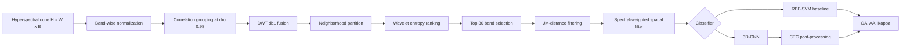

The total reduction depends on the dataset and the JM filtering threshold. In the saved notebook run:

| Dataset | Original | Correlation + DWT | Top entropy | After JM | After Stage 4 |
|---|---:|---:|---:|---:|---:|
| Indian Pines | 200 | 84 | 30 | 22 | 22 |
| Salinas | 204 | 31 | 30 | 22 | 22 |
| KSC | 176 | 119 | 30 | 19 | 19 |

## Repository Structure

```
efficient-band-selection-algorithm-for-landfill-detection-from-hyperspectral-images/
│
├── assets/
│   └── hyperspectral_band_selection_logo.svg  # Project logo
│
├── notebooks/
│   └── band-selection-algo.ipynb              # Full pipeline notebook (Stages 1–5)
│
├── results/
│   ├── band_visualization.png
│   ├── band_reduction.png
│   ├── cec_improvement.png
│   ├── classification_maps.png
│   ├── confusion_matrices.png
│   ├── correlation_matrices.png
│   ├── filtering_comparison.png
│   ├── groundtruth_visualization.png
│   ├── jm_distances.png
│   ├── oa_comparison.png
│   ├── per_class_accuracy.png
│   ├── training_history.png
│   └── wavelet_entropy.png
│
├── .gitignore
├── README.md
└── requirements.txt
```

The `results/` directory contains visual outputs from the notebook run. Intermediate NumPy arrays, classification maps, and trained models may also be saved during execution to the notebook's working directory.

## Theoretical Workflow

### Stage 1: Loading and Preprocessing

Stage 1 loads each `.mat` hyperspectral cube and associated ground-truth map, extracts the required arrays, normalizes the cube, splits labeled pixels into partitions, and saves intermediate files.

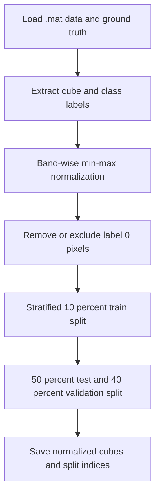

The default Stage 1 label split uses:

- 10% of labeled pixels for training
- 50% for testing
- 40% for validation

The split is stratified on class labels so that the class distribution is represented as evenly as possible across partitions.

### Stage 2: Redundancy Reduction and Fusion

This stage transforms the normalized cube by identifying highly correlated spectral bands and merging correlated groups.

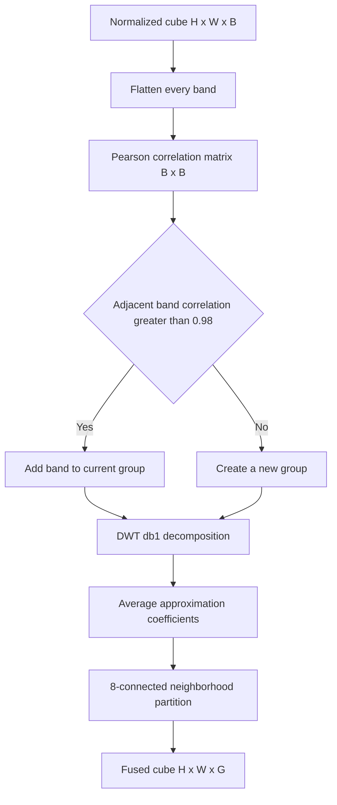

For each pair of band vectors `b_i` and `b_j`, Pearson correlation is calculated as:

```text
rho(i,j) = covariance(b_i, b_j) / (sigma(i) * sigma(j))
```

Bands are considered strongly redundant when every relevant member of a group satisfies a correlation greater than `0.98`.

For a group containing multiple bands:

1. Apply one-level Discrete Wavelet Transform using the `db1` wavelet.
2. Extract approximation coefficients for each band.
3. Average the approximation coefficients.
4. Reconstruct or convert the averaged coefficients into the fused band representation.

If a group contains only one band, that band is retained unchanged. A 3 x 3 uniform neighborhood filter is then blended with the original band using a 0.5 spatial-context weight.

### Stage 3: Information and Separability Filtering

Stage 3 ranks bands by information content and then removes less useful bands based on class separability.

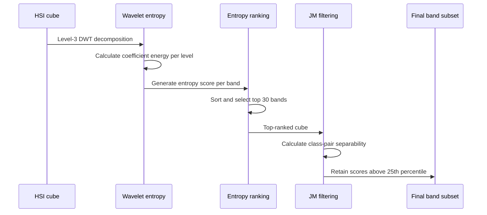

For band `b`, wavelet entropy is computed using the relative energy of its DWT decomposition coefficients:

```text
E_j = sum(coefficients_j^2)
E_total = sum(E_j)
P_j = E_j / E_total
Entropy = -sum(P_j * log(P_j))
```

The implementation uses a level-3 decomposition and ranks bands in descending entropy order.

For JM filtering:

```text
JM = 2 * (1 - exp(-Bhattacharyya_distance))
```

For each candidate band, pairwise class means and variances are used to calculate separability. Non-finite values are replaced with zero, and the valid positive JM scores are used to calculate a percentile threshold. The default percentile is 25, so bands with scores at or above the 25th percentile of valid values are retained.

### Stage 4: Spatial-Spectral Reflectance Filtering

Stage 4 applies a boundary-aware first-order IIR filter to the selected bands. Each pixel is blended with spectrally similar 8-connected neighbors.

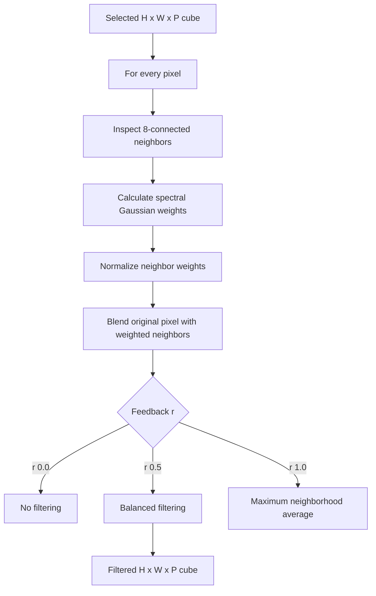

The spectral weight is:

```text
w(i,j) = exp(-||s_i - s_j||^2 / (2 * sigma^2))
```

The notebook uses:

- Feedback parameter `r = 0.5`
- Spectral sensitivity `sigma = 0.1`
- Eight-connected neighborhood processing

The filter is intended to suppress noise in homogeneous regions while preserving boundaries that have large spectral differences.

### Stage 5: Classification and CEC

Stage 5 compares SVM and 3D-CNN classifiers and applies CEC to 3D-CNN predictions.

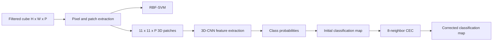

#### SVM Configuration

- Gaussian RBF kernel
- `C = 2`
- `gamma = scale`
- Pixel-level spectral vectors

#### 3D-CNN Configuration

The CNN input patch shape is:

```text
(11 spatial rows, 11 spatial columns, selected spectral bands, 1 channel)
```

A model normally consists of:

- Spectral feature extraction blocks
- 3D convolution and pooling operations
- Flattened or global feature reduction
- Fully connected classification layers
- Softmax output over dataset classes

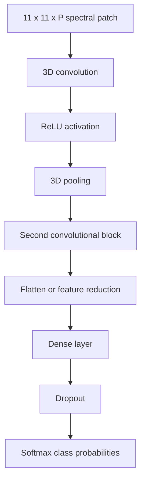

Training settings include:

- Seed: `42`
- Epochs: `100` for Indian Pines and Salinas
- Epochs: `150` for KSC stability training
- Batch size: `64`
- Validation split: `10%`
- Early stopping
- Learning-rate reduction when validation loss plateaus
- Dataset-specific class weighting
- Data augmentation

#### CEC Post-Classification

CEC inspects each pixel and its eight immediate neighbors after classification. The implemented rules use:

1. Clear majority reassignment when neighboring labels support a dominant class.
2. Spectral Angle Mapper (SAM) tie-breaking when competing neighbors are equally represented.
3. Reassignment when all neighbors belong to the same class and differ from the current pixel.
4. Reassignment of isolated pixels that have no neighbors of the same class.

SAM is used as a tie-breaker:

```text
SAM(a,b) = arccos((a dot b) / (||a|| * ||b||))
```

The candidate class with the smallest spectral angle to the pixel is selected in ambiguous cases.

## Methodology Details

### Normalization

The cube is band-wise normalized to the `[0,1]` interval using `MinMaxScaler`. Normalization is needed because spectral bands can have different intensity ranges and to keep learning stable.

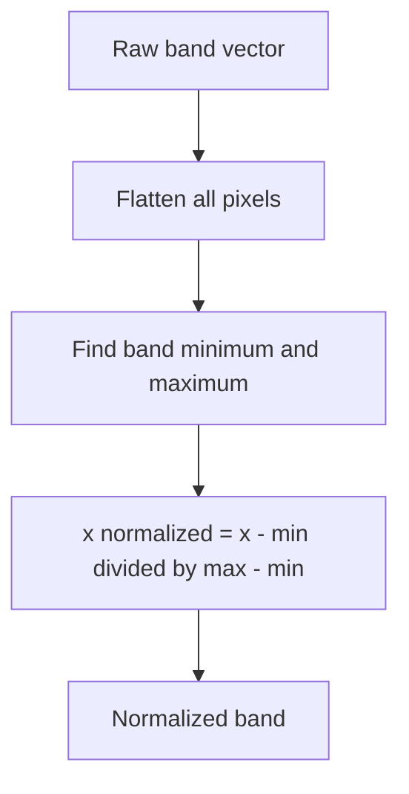

### Data Partitioning

The Stage 1 split is:

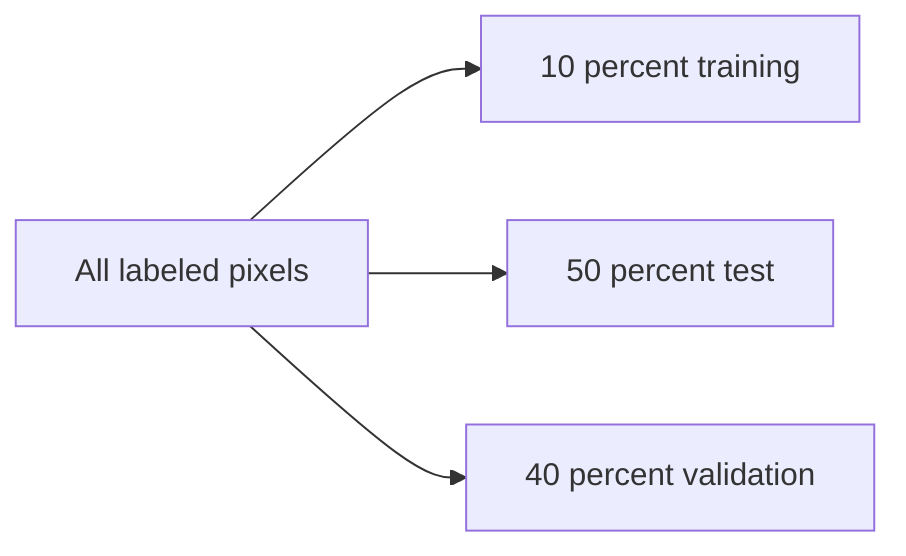

Later, Stage 5 recreates a 30%-training split for the SVM and 3D-CNN comparison so that the CNN has enough labeled patches for training.

### Evaluation Metrics

#### Overall Accuracy

```text
OA = correctly classified pixels / all test pixels
```

#### Average Accuracy

```text
AA = mean(per-class accuracy)
```

#### Cohen's Kappa

Kappa compares observed agreement with chance agreement:

```text
kappa = (p_o - p_e) / (1 - p_e)
```

where `p_o` is observed agreement and `p_e` is chance agreement derived from row and column marginal totals.

## Datasets

### Indian Pines

- Spatial dimensions: `145 x 145`
- 200 spectral bands
- 16 land-cover classes
- 10,249 labeled pixels
- Notebook run final band count: `22`

### Salinas

- Spatial dimensions: `512 x 217`
- 204 spectral bands
- 16 land-cover classes
- 54,129 labeled pixels
- Notebook run final band count: `22`

### Kennedy Space Center

- Spatial dimensions: `512 x 614`
- 176 spectral bands
- 13 land-cover classes
- 5,211 labeled pixels
- Notebook run final band count: `19`

The project uses these source arrays:

| Dataset | Cube variable/key | Ground-truth variable/key |
|---|---|---|
| Indian Pines | `indian_pines_corrected` | `indian_pines_gt` |
| Salinas | `salinas_corrected` | `salinas_gt` |
| KSC | `KSC` | `KSC_gt` |

## Installation

### Prerequisites

- Python 3.9 or later
- Jupyter Notebook or JupyterLab
- NumPy
- SciPy
- Matplotlib
- Scikit-learn
- PyWavelets
- TensorFlow
- tqdm

### Create a Virtual Environment

```powershell
python -m venv .venv
.\.venv\Scripts\Activate.ps1
python -m pip install --upgrade pip
python -m pip install -r requirements.txt
```

For Linux or macOS:

```bash
python -m venv .venv
source .venv/bin/activate
python -m pip install --upgrade pip
python -m pip install -r requirements.txt
```

GPU support for TensorFlow should be installed and configured according to the local operating system and CUDA version.

## Running the Project

### Kaggle Execution

The notebook currently contains Kaggle dataset paths, for example:

```text
/kaggle/input/datasets/freeman2147/1992-indian-pines/
/kaggle/input/datasets/wangyijialili/salinas/
/kaggle/input/datasets/sreevallimanda/ksc-hyperspectral/
```

To execute on Kaggle:

1. Create a Kaggle notebook.
2. Add the three datasets specified in the notebook.
3. Upload or open `band-selection-algo.ipynb`.
4. Enable GPU acceleration.
5. Run all cells or run individual Stage sections sequentially.

### Local Execution

1. Place the three dataset folders in a local directory.
2. Download the `.mat` hyperspectral cubes and ground-truth files.
3. Update the paths in notebook cell 1.2.
4. Update any save/output paths if the notebook uses Kaggle-specific working directories.
5. Start Jupyter:

```powershell
jupyter notebook notebooks/band-selection-algo.ipynb
```

Run the notebook from Stage 1 onward. Stage 5 contains a rebuild section that can regenerate earlier intermediate outputs after a kernel restart.

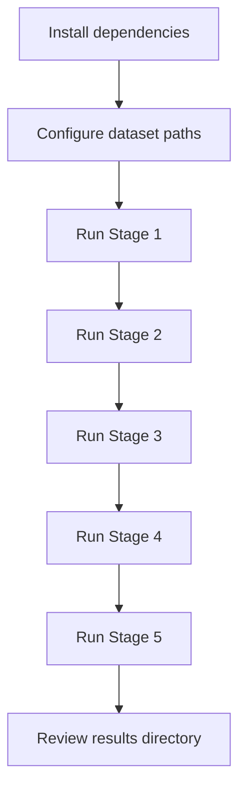

## Configuration Parameters

| Parameter | Default | Location in notebook | Purpose |
|---|---:|---|---|
| Correlation threshold | `0.98` | Stage 2 | Defines highly correlated band groups |
| DWT wavelet | `db1` | Stage 2 | DWT decomposition and band fusion |
| Neighborhood size | `3 x 3` | Stage 2 | Secondary spatial partition |
| Neighborhood blend `alpha` | `0.5` | Stage 2 | Balances original and neighborhood values |
| Top entropy bands | `30` | Stage 3 | Initial candidate band count |
| JM percentile | `25` | Stage 3 | Lower threshold for valid JM scores |
| Feedback `r` | `0.5` | Stage 4 | Spatial filter feedback strength |
| Spectral `sigma` | `0.1` | Stage 4 | Sensitivity of spectral weighting |
| Patch size | `11 x 11` | Stage 5 | 3D-CNN spatial context |
| Random seed | `42` | Stage 5 | Model and NumPy reproducibility |
| Epochs | `100` | Stage 5 | Indian Pines and Salinas |
| KSC epochs | `150` | Stage 5 | Stability run |
| Batch size | `64` | Stage 5 | Mini-batch training |
| CNN validation split | `10%` | Stage 5 | Validation during fitting |

## Experimental Results

The following values are the results saved by the notebook execution.

### Classification Comparison

| Dataset | Method | OA | AA | Kappa |
|---|---|---:|---:|---:|
| Indian Pines | SVM | 64.45% | 46.66% | 0.5770 |
| Indian Pines | 3D-CNN | 98.34% | 98.88% | 0.9811 |
| Indian Pines | 3D-CNN + CEC | 98.62% | 99.26% | 0.9843 |
| Salinas | SVM | 88.85% | 92.66% | 0.8752 |
| Salinas | 3D-CNN | 99.48% | 99.75% | 0.9942 |
| Salinas | 3D-CNN + CEC | 99.50% | 99.78% | 0.9944 |
| KSC | SVM | 61.46% | 43.29% | 0.5625 |
| KSC | 3D-CNN | 69.33% | 56.99% | 0.6573 |
| KSC | 3D-CNN + CEC | 69.68% | 57.40% | 0.6613 |

```mermaid
xychart-beta
    title "Final Overall Accuracy (%)"
    x-axis [Indian Pines, Salinas, KSC]
    y-axis "Accuracy" 0 --> 100
    bar [64.45, 88.85, 61.46]
    bar [98.34, 99.48, 69.33]
    bar [98.62, 99.50, 69.68]
```

CEC produced a small improvement in all three datasets.

| Dataset | OA before CEC | OA after CEC | Improvement |
|---|---:|---:|---:|
| Indian Pines | 98.34% | 98.62% | +0.28 percentage points |
| Salinas | 99.48% | 99.50% | +0.02 percentage points |
| KSC | 69.33% | 69.68% | +0.35 percentage points |

### Band Reduction

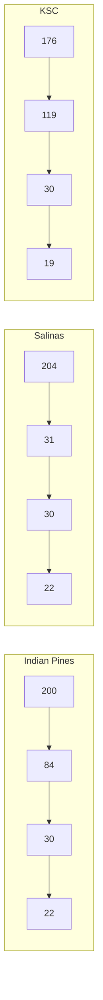

The KSC result is less stable than the Indian Pines and Salinas results. The notebook explicitly trains several KSC models and retains the model with the highest observed OA.

## Generated Outputs

| File | Purpose |
|---|---|
| `band_reduction.png` | Progressive band count for each dataset |
| `band_visualization.png` | Example normalized spectral bands |
| `cec_improvement.png` | OA change before and after CEC |
| `classification_maps.png` | Ground truth, CNN, and CEC maps |
| `confusion_matrices.png` | Dataset-level prediction summaries |
| `correlation_matrices.png` | Spectral band correlation matrices |
| `filtering_comparison.png` | Spatial-filtering effect |
| `groundtruth_visualization.png` | Ground-truth label maps |
| `jm_distances.png` | JM separability scores |
| `oa_comparison.png` | SVM, CNN, and CNN + CEC comparison |
| `per_class_accuracy.png` | Individual class accuracies |
| `training_history.png` | CNN accuracy and loss curves |
| `wavelet_entropy.png` | Band entropy distributions |

### Visual Gallery

#### Classification Maps

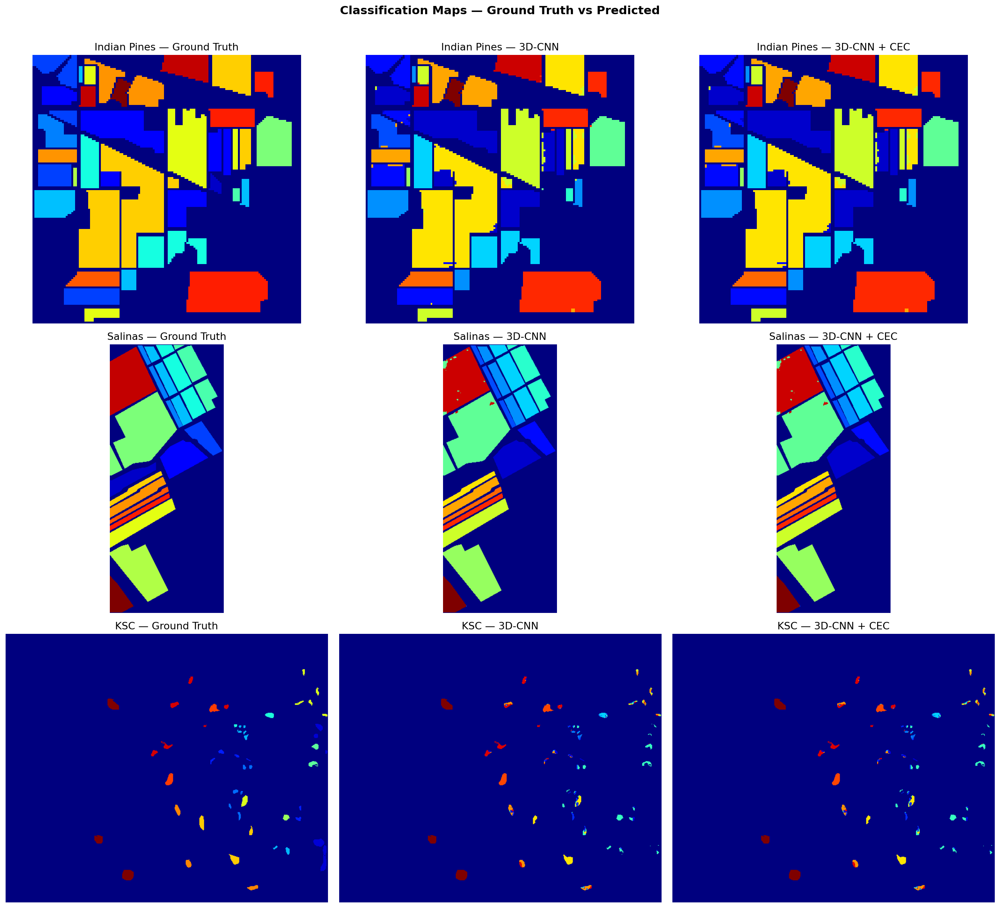

#### Overall Accuracy Comparison

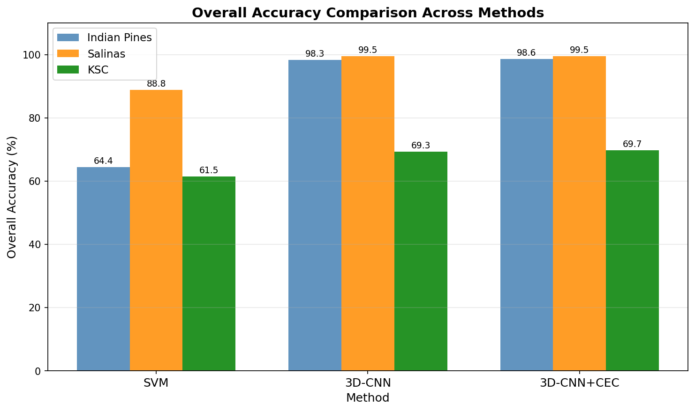

#### Band Reduction

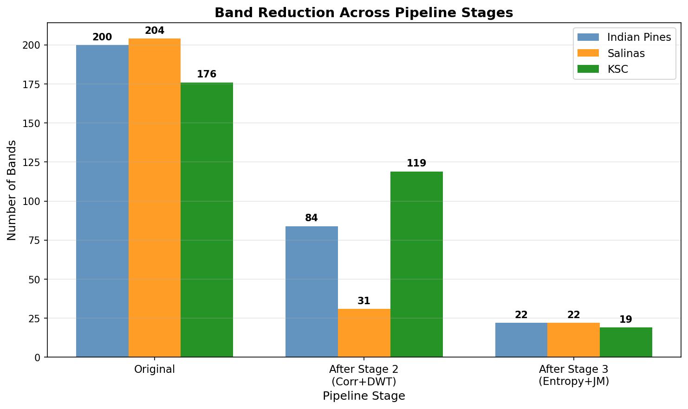

#### Confusion Matrices

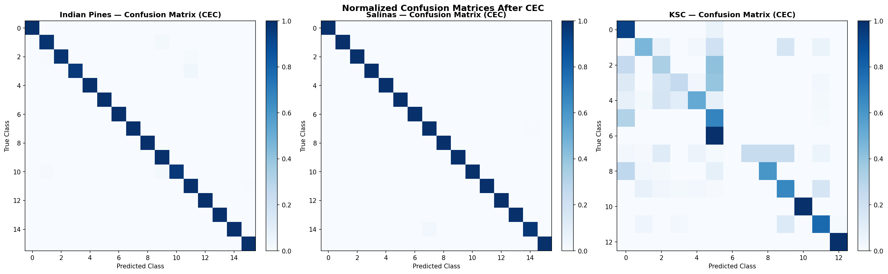

#### CEC Improvement

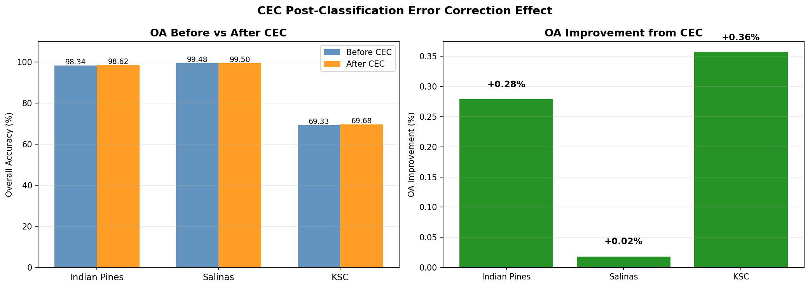

#### Correlation Matrices

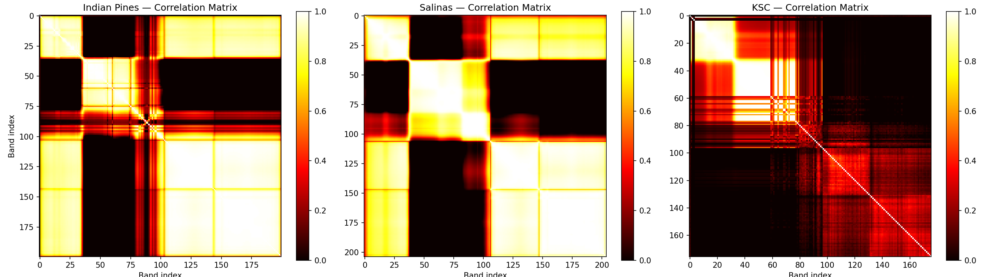

#### Filtering Comparison

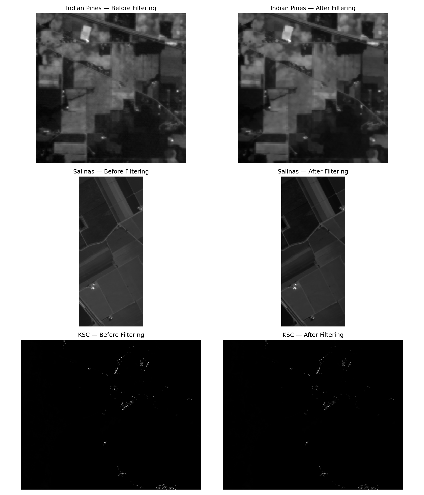

#### Ground-Truth Visualization

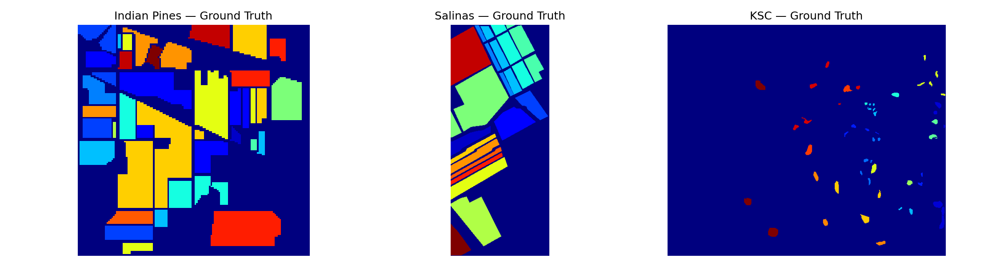

#### JM Distances

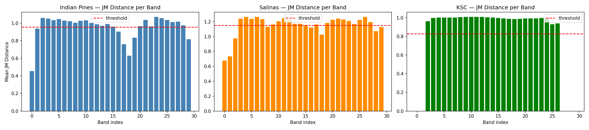

#### Per-Class Accuracy

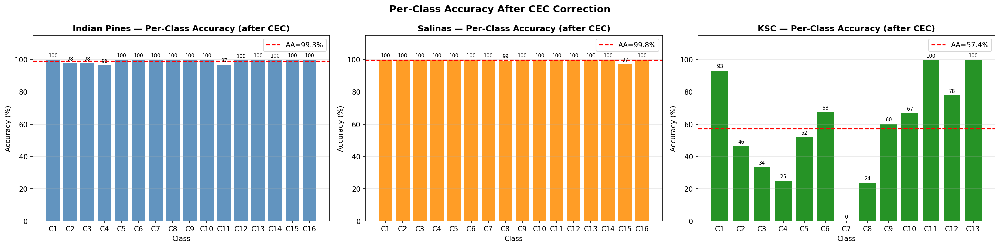

#### Training History

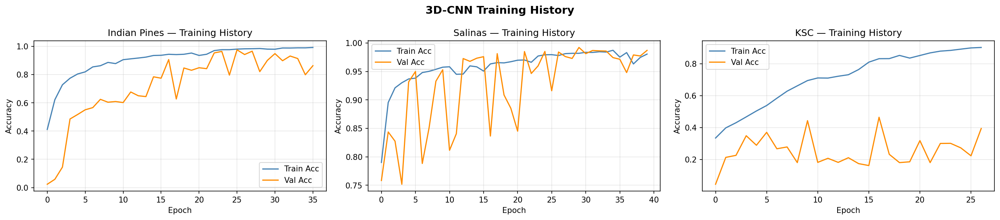

#### Wavelet Entropy

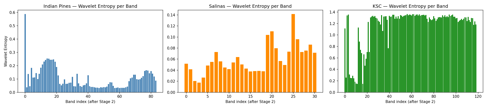

#### Band Visualization

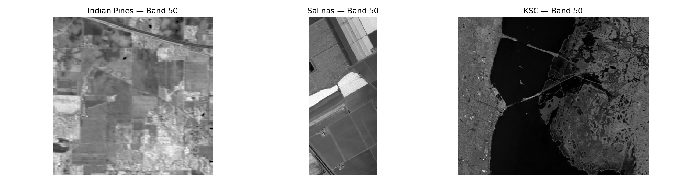

## Result Interpretation

- A lower final band count indicates stronger dimensionality reduction.
- OA indicates the fraction of all test pixels classified correctly.
- AA shows whether a method performs consistently across all classes rather than only on dominant classes.
- Kappa measures agreement while accounting for chance.
- CNN improvement over SVM is mainly due to spatial context, spectral context, and learned nonlinear features.
- CEC improvement is usually modest because the CNN has already removed many isolated errors.
- KSC is more challenging because it has fewer labeled samples across 13 classes and greater class imbalance.
- A high result may vary depending on random splits, augmented data, TensorFlow version, and hardware.

## Reproducibility

The notebook attempts to improve reproducibility through:

- Fixed NumPy, Python, and TensorFlow seed `42`
- Fixed `PYTHONHASHSEED`
- Stratified dataset splits
- Deterministic model seeds where applicable
- Repeated KSC training runs
- Explicit save steps for maps and intermediate arrays
- Final model weight restoration for early stopping

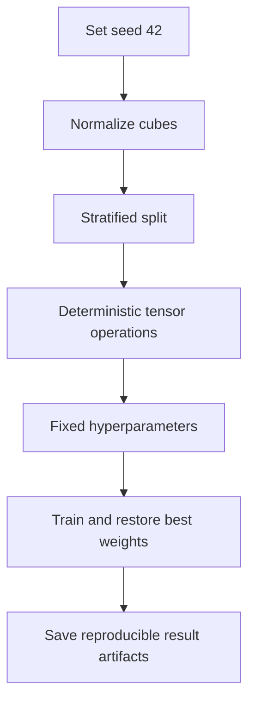

Full mathematical determinism can still vary across GPUs and TensorFlow versions. Comparing repeated runs is recommended for publication-quality claims.

## Limitations

- Dataset loading paths are Kaggle-specific in the current notebook.
- The Stage 2 correlation algorithm is strongly based on pairwise thresholds and adjacent grouping behavior.
- Correlation grouping and JM filtering may be sensitive to selected thresholds.
- The neighborhood filter is computationally expensive for high-resolution cubes such as KSC.
- The 3D-CNN uses a fixed `11 x 11` patch size for every dataset.
- The current CEC implementation is fixed and does not learn correction parameters.
- Repeated KSC training is not guaranteed to achieve the same OA on every platform.
- Kappa and accuracy should be interpreted with class imbalance and labeled-pixel distribution.
- The project does not currently provide a standalone command-line interface or Python package.

## Extending the Project

### Recommended Improvements

1. Move loading and training code from notebook cells into reusable Python modules.
2. Add a CLI or configuration file for dataset paths and thresholds.
3. Replace fixed correlation thresholds with cross-validation or automated threshold search.
4. Add Pareto comparison between band count and classification accuracy.
5. Add cross-validation rather than one fixed train/test partition.
6. Export selected band indices and model artifacts for reproducible deployment.
7. Add attention or graph-based band-selection strategies.
8. Benchmark MobileNet-like, Transformer, and ResNet-inspired hyperspectral models.
9. Add uncertainty estimation and class-activation visualizations.
10. Support additional `.mat`, ENVI, GeoTIFF, and Zarr dataset formats.


## Troubleshooting

### Dataset key error

Verify that the keys printed from `scipy.io.loadmat` match the arrays extracted in the notebook.

```python
from scipy.io import loadmat

data = loadmat("path/to/dataset.mat")
print([key for key in data if not key.startswith("__")])
```

### TensorFlow GPU not detected

Check the installed TensorFlow GPU and CUDA compatibility. Confirm GPU visibility with:

```python
import tensorflow as tf

print(tf.config.list_physical_devices("GPU"))
```

### Stage 4 is slow

Spatial filtering processes 8 neighbors for every selected band and pixel. Reduce the dataset subset or selected band count during development. A GPU does not automatically accelerate the notebook's Python and NumPy neighborhood implementation.

### Out of memory during 3D-CNN training

Reduce patch augmentation, batch size, model capacity, or validate that the dataset size matches available memory.

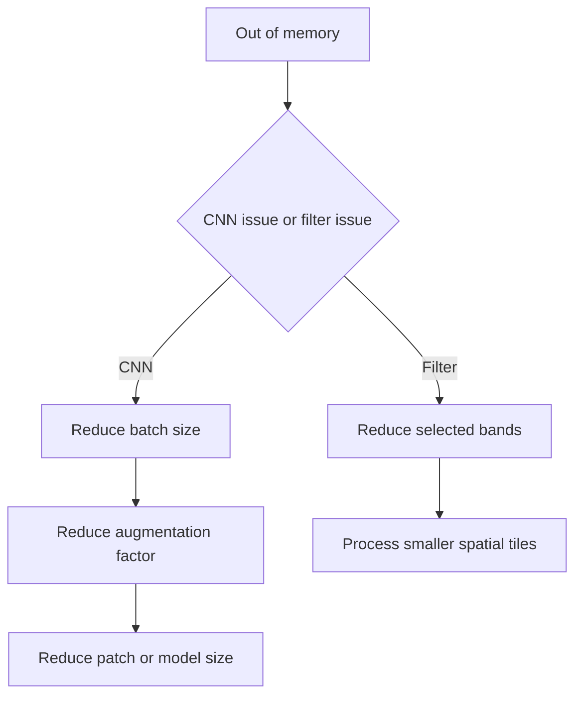

### NaN or invalid JM distances

The JM function replaces NaN values with zero and threshold calculations use only positive valid scores. If too few positive scores remain, adjust the percentile or inspect class variance and population counts.

### Classification result differs from the saved result

Check:

- Dataset split
- TensorFlow version
- GPU configuration
- Patch augmentation factors
- KSC repeated-run selection
- Random seed behavior
- Software-library versions

## References and Concepts

The implementation is based on the following concepts referenced throughout the notebook:

- Kumar et al. (2024), for correlation partitioning, wavelet-based ranking, and hemispherical reflectance spatial filtering concepts.
- Medjahed et al. (2016), for the correlation threshold and context error correction concepts.

The notebook should be paired with the final research report or paper for complete citations, equations, experimental protocol, and attribution details.

## License

No license file is included in the current repository. Add an appropriate open-source license before redistributing, publishing, or commercially deploying this implementation.
